<table border="0">
  <tr>
    <td width="240" align="center" valign="middle">
      
        
      
      
      
    </td>
    <td width="380" valign="middle" align="left">
      <samp><b>[ 1P · READY ]</b> &nbsp;·&nbsp; CREDITS: ∞ &nbsp;·&nbsp; LVL: SYS_ARCH</samp>
        
      <b>KVLNK12305 // VENKATA LAKSHMI NARASIMHA KUSHAL</b> 
      <samp>CS Engineering @ Amrita Vishwa Vidyapeetham</samp>
        
      <em>Understanding software down to the byte and packet level, not just the framework layer. Deep in systems internals with Rust, offensive security research at Init Club, and building custom dev tools.</em>
        
      
    </td>
  </tr>
</table>

 

> CS Engineering at Amrita Vishwa Vidyapeetham. 
> Systems programming, offensive security research, and protocol-level tooling.

Understanding software down to the byte and packet level, not just the framework layer. 
Currently deep in systems internals with Rust, security research at Init Club, and building custom dev tools.

`STAGE 01` &nbsp; **[CVE-2026-41089](https://github.com/KVLNK12305/CVE-2026-41089)** &nbsp;·&nbsp; <samp>python</samp> &nbsp;·&nbsp; <kbd>BOSS: CVSS 9.8</kbd> 
Proof of concept for Netlogon CLDAP stack buffer overflow (CVSS 9.8 Critical).

`STAGE 02` &nbsp; **[GhostShell](https://github.com/KVLNK12305/GhostShell)** &nbsp;·&nbsp; <samp>rust</samp> &nbsp;·&nbsp; <kbd>CO-OP / HCI</kbd> 
HCI exploration platform built with systems-level Rust.

`STAGE 03` &nbsp; **[nitrostack](https://github.com/KVLNK12305/nitrostack)** &nbsp;·&nbsp; <samp>typescript</samp> &nbsp;·&nbsp; <kbd>INFRA</kbd> 
Framework for building, testing, and deploying production-ready MCP servers.

`STAGE 04` &nbsp; **[K.A.I.R.O](https://github.com/KVLNK12305/K.A.I.R.O)** &nbsp;·&nbsp; <samp>dart, flutter</samp> &nbsp;·&nbsp; <kbd>FOCUS ENGINE</kbd> 
Personal focus enforcement engine and energy economy tracker.

`STAGE 05` &nbsp; **[BlueHammer](https://github.com/KVLNK12305/BlueHammer)** &nbsp;·&nbsp; <samp>c</samp> &nbsp;·&nbsp; <kbd>EXPLOIT LAB</kbd> 
Vulnerability research and exploitation lab.

<samp>rust &nbsp; c &nbsp; c++ &nbsp; python &nbsp; java &nbsp; typescript &nbsp; go &nbsp; dart &nbsp; linux &nbsp; redis &nbsp; mysql</samp>

 
<samp><b>[ ARCADE TROPHY CABINET // UNLOCKED ACHIEVEMENTS ]</b></samp>
  

Every graphic here is generated inside this repository by a scheduled action. 
Zero third-party requests, zero external rate-limits, zero broken badges.

`ascii.svg` maps a photo through a character ramp via `scripts/make_portrait.py`; stat graphics, section headings, and `quote.svg` are rendered straight from GitHub's GraphQL API. All typography is inlined JetBrains Mono WOFF2.

 

 
<samp><b>GAME OVER? CONTINUE [ 9 ]</b> &nbsp;·&nbsp; INSERT COIN TO RESTART</samp> 
<samp><i>"See you space cowboy..."</i></samp>

